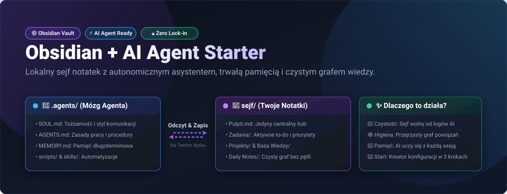
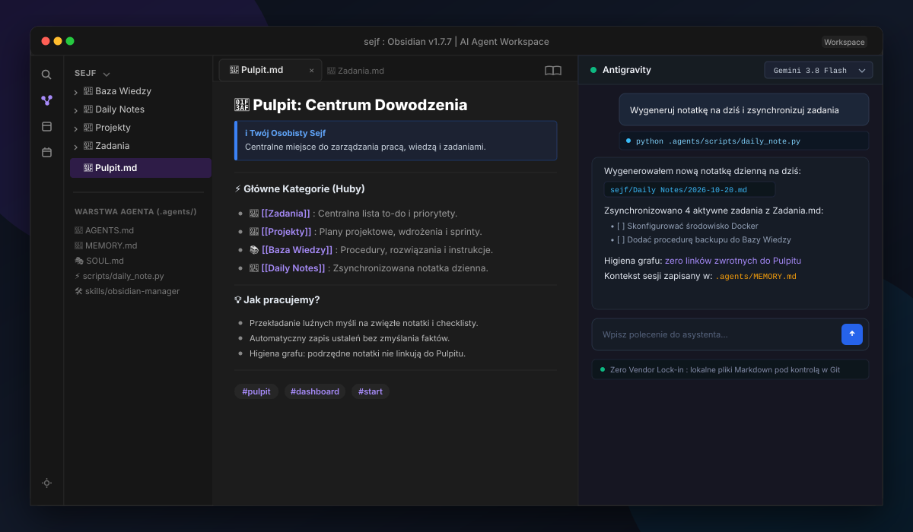
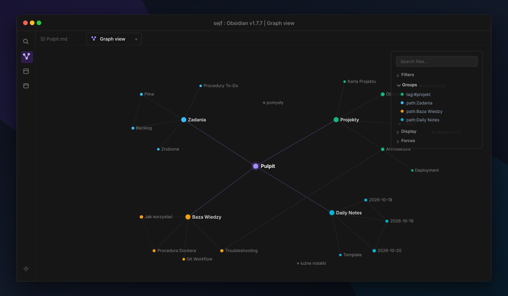
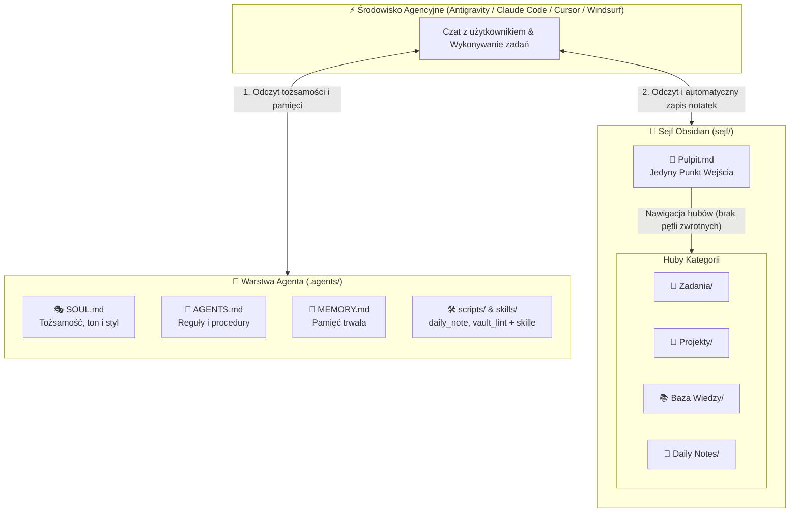

# 🧠 Obsidian + AI Agent Starter Pack

[](LICENSE)
[](https://obsidian.md)
[](https://python.org)
[]()



> Gotowy, modularny szablon łączący Twój lokalny sejf notatek **Obsidian** z autonomicznym **Agentem AI** (np. Antigravity, Claude Code, Cursor, Windsurf) i dowolnym wybranym modelem.
>
> ✅ Przetestowane w **Antigravity** na modelu **Gemini Flash 3.8** oraz w **OpenCode** na modelu **MiMo-V2.6-Flash Free**.

---

## 📸 Podgląd w Działaniu

### 1. Centrum Dowodzenia i Współpraca z Agentem AI
Twój sejf posiada uporządkowany Pulpit wejściowy, a asystent AI na bieżąco odczytuje zadania, aktualizuje projekty i rejestruje nową wiedzę w czystym formacie Markdown:



### 2. Czysty Graf Powiązań (Higiena Grafu Wiedzy)
Koniec z chaotycznymi pajęczynami, w których każda notatka linkuje bezsensownie do strony głównej. Zastosowano ścisłą regułę hierarchii: `Pulpit` łączy się wyłącznie z hubami kategorii, a notatki szczegółowe łączą się horyzontalnie między sobą:



---

## 🏗️ Architektura: Separacja Logiki od Danych (Separation of Concerns)

Większość poradników uczy wrzucania plików konfiguracyjnych bezpośrednio do sejfu notatek. W tym szablonie zastosowano czystą architekturę inżynierską:

```text
WORKSPACE/
├── .agents/                      <-- 🤖 Warstwa operacyjna (Mózg Agenta)
│   ├── SOUL.md                   # Tożsamość, charakter i styl asystenta
│   ├── AGENTS.md                 # Kodeks i zasady postępowania agenta
│   ├── MEMORY.md                 # Pamięć długoterminowa asystenta
│   ├── ONBOARDING.md             # Kreator pierwszego uruchomienia (usuwany automatycznie po konfiguracji)
│   ├── scripts/                  # Automatyzacje i skrypty w Pythonie
│   │   ├── daily_note.py         # Generator notatki dziennej i zadań
│   │   └── vault_lint.py         # Linter higieny grafu i spójności sejfu
│   └── skills/                   # Specjalistyczne umiejętności agenta
│       ├── obsidian-manager/     # Standardy formatowania, higiena grafu i wikilinki
│       ├── grilling/             # Uniwersalny wywiad decyzyjny z rekomendacjami
│       └── vault-lint/           # Narzędzie audytu i naprawy spójności sejfu
│
├── sejf/                         <-- 📓 Czysty Sejf Obsidian (Twoje Dane)
│   ├── Pulpit.md                 # Główny dashboard i centrum dowodzenia
│   ├── Zadania/                  # Aktywne listy zadań i checklisty
│   ├── Projekty/                 # Notatki projektowe
│   ├── Baza Wiedzy/              # Procedury, instrukcje i wiedza
│   └── Daily Notes/              # Notatki dzienne
│
├── assets/                       # Grafiki i wizualizacje architektury
├── .gitignore
└── README.md
```

### Przepływ Informacji w Systemie



### Dlaczego taki podział?
1. **Czystość w Obsidianie:** W aplikacji Obsidian otwierasz wyłącznie podfolder `sejf/`. Twój graf powiązań i drzewo plików są wolne od technicznych skryptów, logów i reguł.
2. **Higiena grafu wiedzy:** Zastosowano regułę czystego grafu: `Pulpit` łączy się wyłącznie z hubami kategorii, a notatki podrzędne nie zaśmiecają widoku grafu linkami zwrotnymi do pulpitu.
3. **Pełna sprawczość agenta:** Otwierając katalog główny (`WORKSPACE`) w środowisku agencyjnym, agent widzi zarówno Twoje notatki w `sejf/`, jak i swoje instrukcje w `.agents/`.
4. **Domyślny zapis bez halucynacji:** Asystent automatycznie rejestruje ustalenia, plany i decyzje w sejfie, a w razie wątpliwości pyta zamiast zmyślać nieomówione fakty.
5. **Pamięć na Twoim dysku (Zero Lock-in):** Koniec z zamykaniem wiedzy w chmurze korporacji. Twoja pamięć AI żyje w pliku `MEMORY.md`, który możesz wersjonować w Git.
6. **Osobowość skrojona na miarę:** W pliku `SOUL.md` asystent przechowuje swój charakter, ton głosu i model relacji z Tobą.

---

## 🚀 Szybki Start w 3 Krokach

### Krok 1: Pobierz szablon
* **Opcja A (Git):** Sklonuj repozytorium na swój dysk:
  ```bash
  git clone https://github.com/Dawe1600/obsidian-ai-starter.git
  ```
* **Opcja B (Bez Gita: ZIP):** Pobierz najnowszą paczkę z zakładki [Releases](https://github.com/Dawe1600/obsidian-ai-starter/releases) lub kliknij zielony przycisk **`<> Code`** -> **Download ZIP** na samej górze strony i rozpakuj archiwum w wybranym miejscu na dysku.

> [!TIP] Samoczyszczący instalator
> Nie musisz ręcznie usuwać grafik demonstracyjnych ani plików konfiguracyjnych. Po przeprowadzeniu wywiadu w Kroku 2, asystent AI automatycznie usunie zbędne materiały (`assets/`, `ONBOARDING.md`), pozostawiając idealnie czysty sejf.

### Krok 2: Otwórz Workspace i Skonfiguruj Asystenta
1. Uruchom swoje narzędzie agencyjne (np. **Antigravity**, **Cursor**, **Claude Code**, **Cline**, **Windsurf** itp.).
2. Jako katalog roboczy (Workspace) otwórz **główny folder projektu** (ten zawierający zarówno `.agents/`, jak i `sejf/`).
3. Wybierz swój preferowany model (np. Claude, Gemini, GPT lub model lokalny).
4. Napisz dowolną pierwszą wiadomość (np. *„Cześć, zacznijmy!”*).
   * Agent automatycznie wykryje pierwsze uruchomienie, przeprowadzi krótki wywiad w 3 krokach i sam zbuduje strukturę sejfu oraz skonfiguruje pliki `SOUL.md`, `AGENTS.md` i `MEMORY.md`.

### Krok 3: Otwórz Sejf w Obsidianie
1. Uruchom program **Obsidian**.
2. Kliknij **Otwórz folder jako sejf** (Open folder as vault).
3. Wskaż podfolder `sejf/` i ciesz się gotowym, spersonalizowanym centrum dowodzenia!

---

## ⚙️ Wbudowane Skrypty i Narzędzia

W folderze `.agents/scripts/` znajdują się gotowe narzędzia w standardowym Pythonie 3 (zero zewnętrznych instalacji `pip`):
* `daily_note.py`: automatycznie tworzy nową notatkę dzienną w `sejf/Daily Notes/YYYY-MM-DD.md` i zaciąga aktywne zadania z pliku `sejf/Zadania/Zadania.md`.
* `vault_lint.py`: błyskawiczny linter spójności sejfu. Sprawdza higienę grafu (brak linków zwrotnych do Pulpitu), wykrywa martwe wikilinki, osierocone notatki i brakujące tagi.

Uruchomienie w terminalu:
```bash
# Generator notatki dziennej
python .agents/scripts/daily_note.py

# Audyt higieny sejfu
python .agents/scripts/vault_lint.py
```

> [!TIP] Brak Pythona na komputerze? Żaden problem!
> Skrypt Pythona to tylko opcjonalne ułatwienie. Twój asystent AI potrafi wykonać dokładnie to samo bezpośrednio w oknie czatu: wystarczy napisać: *„Wygeneruj moją notatkę na dziś”*, a agent utworzy plik sam, bez potrzeby instalowania czegokolwiek.

---

## ❓ Najczęściej Zadawane Pytania (FAQ)

### Czy to działa na Windowsie, macOS i Linuksie?
Tak. Zarówno pliki Markdown w Obsidianie, jak i skrypt w standardowym Pythonie 3 działają w 100% identycznie na każdym systemie operacyjnym.

### Czy muszę płacić za modele AI?
Nie. Możesz korzystać ze środowisk takich jak **Antigravity** na darmowym planie, narzędzi typu **Open Code**, bezpłatnych kluczy API (np. darmowy dostęp do modeli Gemini w Google AI Studio) lub całkowicie darmowych modeli lokalnych uruchomionych na własnym komputerze przez Ollama (np. Llama 3, Qwen).

### Gdzie przechowywane są moje notatki i pamięć agenta?
Wszystkie notatki w sejfie oraz pamięć długoterminowa asystenta (`MEMORY.md`) żyją w 100% na Twoim dysku twardym w otwartym formacie Markdown. Masz pełną kontrolę nad swoimi danymi i zero vendor lock-inu. Wybór modelu AI należy do Ciebie: możesz korzystać z wygodnych modeli chmurowych (np. Gemini, Claude, GPT) lub uruchomić w pełni lokalny model przez Ollama (np. Llama 3, Qwen).

### Co jeśli nie mam lub nie znam Pythona?
Nie musisz mieć ani znać Pythona! Twój asystent AI potrafi wykonać wszystkie operacje bezpośrednio na plikach Markdown w oknie czatu. Jeśli jednak chcesz korzystać ze skryptu w tle, możesz zainstalować Pythona w 10 sekund jedną komendą:
* **Windows (PowerShell):** `winget install Python.Python.3.12`
* **macOS:** `brew install python`
* **Linux:** `sudo apt install python3`

---

## 📄 Licencja & Społeczność
Szablon jest całkowicie darmowy (licencja MIT). Możesz go dowolnie modyfikować i dopasowywać pod swój workflow.
